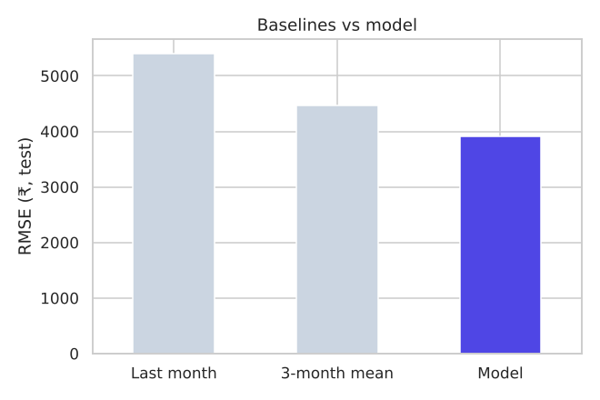
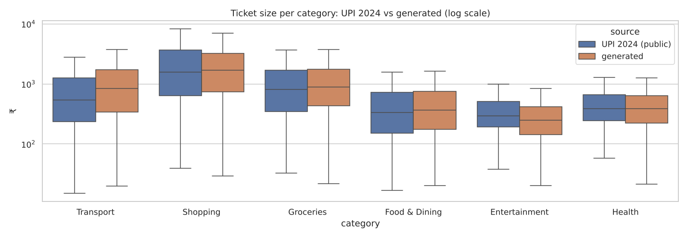

# 💰 Smart Finance Tracker (India) - ML-powered personal finance

A Streamlit app that **auto-categorises bank transactions, detects subscriptions, forecasts next month's spending,
recommends a budget and assigns a spending persona**. It uses classical ML only (scikit-learn, XGBoost, LightGBM),
with an MLOps setup of MLflow tracking, versioned model files and Docker.

> Built for the *Fundamentals of Computing for Data Science Lab* PBL / Mini Project.
> Models are trained on synthetic multi-user data **calibrated with three public datasets and official HCES data**, and the
> categorizer is also trained and externally tested on public dataset #1 (see [Data](#-data-honest-statement)).
> The numbers below are *not* real-world performance.

## ✨ Features

| Area | Feature | Type |
|---|---|---|
| Transactions | Auto-categorisation with confidence + "Needs review" badge | **ML** - text classification (TF-IDF + Logistic Regression) |
| | Inline category correction saved to SQLite (kept as future training feedback) | Non-ML |
| | Subscription / recurring-payment detection | **ML** - binary classification (XGBoost) |
| | Autopay for subscriptions (**simulated**, no money moves) | Non-ML |
| Forecasting | Next-month spend per category with a 10-90% range | **ML** - tabular regression on lag/rolling features |
| | Savings forecast, recommended budget with reasons | ML-derived + rules |
| Insights | Spending persona | **ML** - clustering (K-Means) |
| | Weekend vs weekday **hypothesis test** (Mann-Whitney U), fastest-growing categories, top merchants | Statistics |
| | **Unusual transaction alerts** (Q3 + 3×IQR rule per category) | Statistics |
| App | Dashboard, goals with feasibility, CSV / bank-statement import | Non-ML |
| | Admin page: model versions, test metrics vs baseline, comparison tables, plots, user-feedback stats | MLOps |

**Imbalanced data → SMOTE.** Both classifiers face imbalanced classes (categorizer: 11.6 : 1 between the largest and
smallest category; subscription detector: ~7.1% positives). Every candidate model is trained three ways:
**no reweighting**, **`class_weight="balanced"`** (or `scale_pos_weight` for XGBoost) and **SMOTE**. SMOTE sits *inside* an
`imblearn` `Pipeline`, so synthetic samples are generated only from the training folds and never from validation or
test data. The comparison tables below show the outcome honestly: on this data **SMOTE did not beat the unweighted
models**, so it was not selected. It stays in the code as a tested option.

## 🧱 Architecture

```
finance-tracker/
├── app.py                  # Streamlit app (7 pages, one function per page)
├── src/
│   ├── data_prep.py        # public-data loaders, synthetic generator (HCES-calibrated), cleaning
│   ├── features.py         # features for all 4 models - shared by training AND serving
│   ├── train.py            # compare models, MLflow logging, single test evaluation, versioned saving
│   └── services.py         # app logic: DB, predictions, forecast, budget, autopay (simulated), patterns
├── notebooks/eda.ipynb     # 4 EDA sections, each with "Findings and Decisions"
├── data/SOURCES.md         # every dataset, URL, licence, how it is used
├── models/                 # <name>_v<N>.joblib + model_info.json (registry)   [generated]
├── results/                # model_comparison_*.csv, plots, summary.md
├── Dockerfile, docker-compose.yml
```

## 🚀 Quick start

### Local (Python 3.12+)
```bash
python -m venv .venv && source .venv/bin/activate      # Windows: .venv\Scripts\activate
pip install -r requirements.txt
python -m src.data_prep        # load public data + generate + clean  (~1.5 min)
python -m src.train            # train all 4 modules    (~12 min on 2 CPU cores)
streamlit run app.py           # http://localhost:8501
mlflow ui --backend-store-uri sqlite:///mlruns/mlflow.db   # http://localhost:5000
```
In the app, type any username, click **Create account**, then **📦 Load demo data** to fill every page with 24
months of a generated user's history.

### Docker
```bash
docker compose build
docker compose run --rm app python -m src.data_prep && docker compose run --rm app python -m src.train
docker compose up            # app → http://localhost:8501, MLflow → http://localhost:5000
```
Models, data, results, MLflow runs and the SQLite DB (`./db/`) are mounted as volumes, so they survive restarts.
Train either locally or in Docker, not both: MLflow stores absolute artifact paths. To switch, delete `mlruns/`.

> Python 3.12 is used instead of 3.11 because the pinned NumPy 2.5 / XGBoost 3.4 / SHAP 0.54 releases require ≥ 3.12.

## 📊 Data (honest statement)

There is **no public dataset of real, labelled, multi-month personal transactions for Indian users**, because that data
is private. This project therefore uses a hybrid approach:

| Source | Kind | Used for |
|---|---|---|
| **#1 HF Transaction Dataset** (1,000 rows, `data/raw/hf_transactions.csv`) | Public, synthetic | **Categorizer:** 306 debit rows added to training; external test on 307 rows of seen merchants plus **232 rows of 13 merchants held out completely** (never in the generator or training). **Generator:** 16 real merchant names added (Pizza Hut, Zara, Dentist, ...). Labels mapped per merchant (Blinkit → Groceries, Netflix → Subscriptions, Gym → Personal Care, ...) |
| **#2 UPI Transactions 2024** (250,000 rows, `data/raw/upi_transactions_2024.csv`) | Public, simulated | **Generator calibration:** number and size of payments per category follow the real UPI ticket-size distribution (median + log-sd; e.g. Food ₹332, Groceries ₹819, Shopping ₹1,566). Weekend pattern taken from the data: **no weekend effect** (ratio 0.98-1.05). EDA comparison |
| **#3 Credit Card Spending India** (26,052 rows, `data/raw/credit_card_india.csv`) | Public, simulated | EDA cross-check of category shares and of spend-mix differences between cities and card types (clustering EDA). Its near-uniform split across expense types conflicts with HCES, so it is **not** used for calibration |
| **MoSPI HCES 2023-24** factsheet / press note | **Official government data** | Generator category shares (urban): food 39.68%, processed food & beverages 11.09%, conveyance 8.46%, durables 6.87%, rent 6.58%. Other groups are approximate (marked in code) |
| `generate_data()` in `src/data_prep.py` | **Generated by us** | 300 users × 24 months (~349k transactions) with Indian merchants and narration styles (`UPI/ZOMATO/483921/Payment`, `ACH D- LIC OF INDIA …`, `NEFT-RENT-JUN`), noise (typos, truncation, case, reference IDs), ~5% ambiguous P2P payments, recurring streams with ±2-day jitter, hard negatives/positives. **Forecasting, subscription detection and clustering need multi-month per-user histories, which none of the public datasets has, so those three models train on this data** |
| Indian Bank Statements (AgamiAI, Apache 2.0) | Public, synthetic | Not downloaded; narration formats are written in its style |
| Your own bank statement | **Real, private** | Optional: import via the app's CSV upload or `import_bank_csv()`; never committed |

All three public datasets are themselves simulated or synthetic. They make the data more realistic (merchant names, ticket
sizes, an external labelled test), but none of them is real personal behaviour. Column inspection, mappings and licence
notes are in `data/SOURCES.md`. The public CSVs are committed so a clean clone reproduces the results. Check their licences
before making the repo public.

Hidden `archetype` labels (Saver, Lifestyle Spender, ...) are **never given to any model**. They are used only for a
post-hoc sanity check of the clusters (Adjusted Rand Index).

Known deviations from HCES: generated rent is ~15% of spend vs 6.6% in HCES. HCES averages over homeowners who pay no
rent, while a renting household typically pays 15-28% of income. Groceries are correspondingly lower.

## 🧪 Methodology

* **No leakage:** each model is one scikit-learn/imblearn `Pipeline` (preprocessing [+ SMOTE] + model), fitted only on
  training folds. Forecasting uses a **chronological split** (train → 4 validation months → last 3 months test), and
  `check_forecast_leakage()` asserts that features for month *t* are identical with and without data after *t*.
  Subscription CV is **grouped by user** (`StratifiedGroupKFold`), and clustering is fit on 80% of users and checked on the held-out 20%.
* **Select on validation, report on test once**, always against a **baseline**. If two models are within noise (1 std of CV
  score, or 1% RMSE), the faster or simpler one is chosen and the script says so.
* Light tuning with `RandomizedSearchCV` (≤ 10 iterations). Fixed `SEED = 42` everywhere.
* **Quality gate:** `model_info.json` is updated only if the winner beats its baseline.

## 📈 Results (from the last `python -m src.train` run)

### 1. Auto-categorisation - primary metric macro F1 (stratified 5-fold CV on 19,506 training rows = 19,200 synthetic + 306 from public dataset #1)

| Model | CV macro F1 | ± std | CV accuracy |
|---|---|---|---|
| Baseline: majority class | 0.0201 | 0.0000 | 0.1777 |
| NaiveBayes | 0.9615 | 0.0028 | 0.9543 |
| NaiveBayes + SMOTE | 0.9595 | 0.0032 | 0.9541 |
| LogReg | 0.9732 | 0.0018 | 0.9633 |
| LogReg + balanced | 0.9597 | 0.0032 | 0.9583 |
| LogReg + SMOTE | 0.9616 | 0.0024 | 0.9591 |
| LinearSVM(cal) | 0.9729 | 0.0019 | 0.9623 |
| LinearSVM(cal) + balanced | 0.9710 | 0.0018 | 0.9614 |
| LinearSVM(cal) + SMOTE | 0.9621 | 0.0021 | 0.9587 |
| RandomForest + balanced | 0.9637 | 0.0016 | 0.9604 |
| LightGBM + balanced | 0.9664 | 0.0018 | 0.9614 |

**Winner: LogReg** (tuned; LinearSVM was within noise and slower).

| Test set | Rows | Macro F1 | Accuracy |
|---|---|---|---|
| Synthetic test split | 4,800 | **0.976** | 0.967 |
| Majority-class baseline (same split) | 4,800 | 0.020 | 0.178 |
| **External: public dataset #1, merchants seen in training** | 307 | 1.000 | 1.000 |
| **External: public dataset #1, merchants never seen** (13 held-out merchants) | 232 | **0.535** | 0.461 |
| Same unseen rows, model trained on synthetic data only | 232 | 0.525 | 0.422 |
| Synthetic, merchants never seen (diagnostic split by merchant) | - | 0.337 | - |

**How to read this:** known merchants are solved almost perfectly; **new merchants are the real difficulty (macro F1 ≈ 0.5)**. Some held-out names share a brand word with known merchants ("Ola Cab", "IRCTC Ticket"), which helps. Others ("Eye Checkup", "Pathology Lab", "Nike Store") are genuinely new. Adding dataset #1's rows to training helps only slightly on unseen merchants (+0.01). This is why the app has a *Needs review* flag and stores user corrections.
Confidence threshold **0.65**, chosen on a validation split of *unseen merchants* drawn from the training data (test data untouched). It is the most accurate threshold that still auto-accepts ≥25% of new-merchant rows (~81% correct when accepted; curve in `results/categorizer_threshold_curve.csv`). Known merchants are almost always above it (~5% of the demo user's rows are flagged), so *Needs review* mainly catches new and ambiguous payments.
SMOTE and class weights both *lowered* macro F1 here: even the smallest class has a few hundred distinctive training examples, so oversampling mainly adds interpolated noise to the sparse TF-IDF space.

### 2. Subscription detection - primary metric F1 (positive class), CV grouped by user

| Model | CV F1 | ± std | CV PR-AUC |
|---|---|---|---|
| Baseline: rule (>=3 payments & gap std < 3d) | 0.4015 | 0.0348 | - |
| LogReg | 0.9532 | 0.0047 | 0.9920 |
| LogReg + balanced | 0.8938 | 0.0074 | 0.9896 |
| LogReg + SMOTE | 0.8997 | 0.0069 | 0.9895 |
| RandomForest | 0.9921 | 0.0032 | 0.9998 |
| RandomForest + balanced | 0.9921 | 0.0020 | 0.9997 |
| RandomForest + SMOTE | 0.9931 | 0.0024 | 0.9998 |
| GradientBoosting | 0.9911 | 0.0037 | 0.9994 |
| GradientBoosting + SMOTE | 0.9908 | 0.0029 | 0.9996 |
| XGBoost | 0.9937 | 0.0019 | 0.9997 |
| XGBoost + scale_pos_weight | 0.9928 | 0.0025 | 0.9998 |
| XGBoost + SMOTE | 0.9941 | 0.0031 | 0.9997 |

**Winner: XGBoost** (tuned). **Test:** F1 **0.992**, precision 1.000, recall 0.984, ROC-AUC 0.9997, PR-AUC 0.9983 vs rule baseline F1 0.410 (precision 0.808, recall 0.274).
⚠️ The first version scored F1 0.994. Following the project rule *"if it looks too good, investigate"*, harder cases were added (fixed-price but irregular LPG/wallet top-ups, postpaid bills with varying amounts, house-help salary to a person mixed with random P2P payments, missed months, newly started subscriptions). That dropped the rule baseline to 0.40 and logistic regression to 0.95, but tree models still separate the classes almost perfectly, because on generated data the label is almost a deterministic function of "regular gaps + fixed amount". None of the public datasets has per-user recurring labels, so this module can only be checked on synthetic data. **Treat it as an upper bound.**

### 3. Next-month forecast - primary metric RMSE (₹), chronological split

| Model | Val RMSE | Val MAE | Val R² |
|---|---|---|---|
| Baseline: last month | 5347 | 1127 | 0.527 |
| Baseline: 3-month mean | 4213 | 1067 | 0.706 |
| Ridge | 3900 | 1095 | 0.748 |
| RandomForest | 3810 | 959 | 0.760 |
| GradientBoosting | 3899 | 967 | 0.748 |
| XGBoost | 3900 | 996 | 0.748 |
| LightGBM | 3810 | 984 | 0.760 |
| LightGBM (tuned) | 3794 | - | - |

**Winner: LightGBM** (tuned). **Test (last 3 months):** RMSE **₹3,909**, MAE ₹982, R² 0.751 vs 3-month-mean baseline RMSE ₹4,461 (R² 0.676) and last-month baseline ₹5,394, so **12% lower RMSE than the best baseline**.
Honest caveat: sMAPE is *worse* than the baselines (25.9% vs 22.0% on non-zero months), because the model is better on the big amounts that RMSE weights but slightly worse in relative terms on small ones. The largest errors are in lumpy categories (Travel, Health, Shopping). Forecast range = prediction + 10th/90th percentile of validation residuals (₹-1,095 / +₹962).

### 4. Spending persona - primary metric silhouette

| Algorithm | k | Silhouette | Davies-Bouldin | Smallest cluster | ARI vs hidden archetype |
|---|---|---|---|---|---|
| KMeans | 5 | 0.184 | 1.815 | 17.1% | 0.739 |
| GaussianMixture | 5 | 0.176 | 1.826 | 13.3% | 0.713 |
| KMeans | 7 | 0.172 | 1.840 | 8.8% | 0.707 |
| KMeans | 6 | 0.171 | 1.744 | 8.3% | 0.716 |
| Agglomerative(Ward) | 5 | 0.160 | 1.863 | 10.4% | 0.681 |
| KMeans | 4 | 0.159 | 1.808 | 18.3% | 0.591 |

**Winner: KMeans (k=5)**, the highest silhouette with no tiny cluster. Held-out users: silhouette 0.170, ARI vs hidden archetypes 0.600 (reporting only, never used for training). Silhouette ≈ 0.18 shows that spending styles overlap rather than form crisp groups, which is expected for people (public dataset #3 shows the same: spend mixes differ in only one or two categories between groups).
Personas (named automatically from cluster profiles): Debt-Heavy, Saver, Lifestyle Spender, Student / Early Career, Family Budgeter.

Full tables: `results/summary.md` and `results/model_comparison_*.csv`. Plots: `results/*.png`.

| | |
|---|---|
|  |  |
|  |  |

## 🔁 MLOps

* **Git** for code; data and models are reproducible from code (`data_prep` → `train`).
* **MLflow** (`sqlite:///mlruns/mlflow.db`): one experiment per module. Every candidate run logs params, CV metrics,
  training time and git commit, and the winner run also logs test metrics, the model file and plots.
* **Model registry:** `models/<name>_v<N>.joblib` (full pipeline, version auto-increments) + `models/model_info.json`
  (active version, algorithm, metrics vs baseline, threshold, residual quantiles, persona names). The app loads the active versions once (`st.cache_resource`).
* **Same code for training and serving:** the app calls the feature functions in `src/features.py`.
* **Feedback:** user corrections are stored (`predicted_category` vs `category`), and the Admin page shows the correction
  rate. This is a basic model-health signal and the data a future retraining step would use.
* **Docker:** `app` and `mlflow` services.

## ⚠️ Limitations

* Synthetic / simulated data: the categorizer is near-perfect on known merchants but scores macro F1 ≈ 0.5 on merchants it has
  never seen (external test on public dataset #1). The subscription detector can only be checked on generated data and should be treated as an upper bound.
* No weekend effect in the calibration data (UPI 2024), so the weekend-vs-weekday test and the persona's weekend ratio carry little signal on the demo data.
* Cold start: forecasts need 3 complete months and personas need 3 months of data.
* No real bank integration, no real payments (autopay is simulated), no festival awareness (no reliable festival
  feature data), no drift monitoring or automated retraining (out of scope).
* Very simple login (username only), suitable for a demo, not production.
